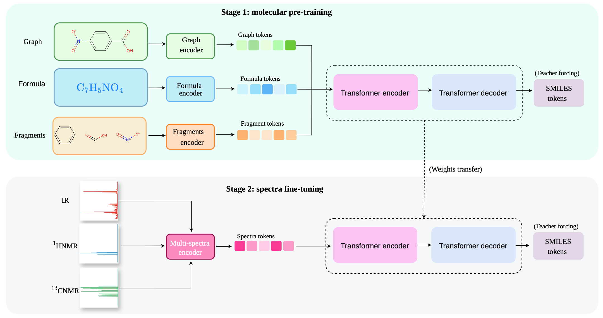

# NMIRacle v2
A new version of the [original model](https://github.com/fedeotto/nmiracle) that explores different conditioning representations (formula, graph, substructures (Morgans/SMARTS vocab))



Structure elucidation is trained in two stages. In **Stage 1** (`sub2struct`) a transformerdecoder learns to write SMILES from a structural description of the molecule. In **Stage 2** (`spec2struct`) the pre-trained transformer is kept and driven by a spectral encoder —
IR, ¹H, ¹³C — instead. The structural representation never appears at inference; it only shapes the prior.

We study exactly this conditioning: (count-aware) fragments (991 SMARTS patterns, or Morgan
counts), the molecular formula, the molecular graph (using a pre-trained, frozen [GraphMVP](https://github.com/chao1224/graphmvp) module), and different combinations.

---

> [!NOTE]
> This repository is an empirical study rather than a finished result. Across the
> conditioning representations we tried, a **graph-based prior transfers best to the spectral
> stage** — consistently better than fragment-conditioning, and combining
> representations did not help. These are single training runs per configuration, so
> treat them as directions rather than conclusions.

## Installation
Install the required dependecies below:
```bash
conda create --name nmiracle python=3.11
conda activate nmiracle
pip install torch==2.6.0 --index-url https://download.pytorch.org/whl/cu126
pip install pytorch_lightning==2.6.1
pip install rdkit
# pip install openbabel-wheel
pip install ogb==1.3.4
pip install torch_geometric

# torch_scatter
git clone https://github.com/rusty1s/pytorch_scatter.git
cd pytorch_scatter
pip install --no-build-isolation .
```
---

## Data availability

We provide data for pre-training dataset (`pretrain_dataset`) and simulated spectra dataset (original data [here](https://zenodo.org/records/14770232)) (`multispectra`). NIST IR-experimental is protected by copyright and cannot be redistributed. However, we provide metadata (`nist_ir_metadata`) information and a script (`nmiracle_v2/scripts/fetch_nist_ir.py`) to recreate the original dataset by downloading the required entries from the original source. Data sources to be used alongside this repo https://huggingface.co/datasets/fedeotto/nmiracle-datasets

> [!NOTE]
> Additional datasets (`nmrsi_dataset`, and `xue_dataset` are still under refactoring and will be uploaded at a later time.)

---

## Checkpoints

We provide all trained checkpoints for both Stage 1 (`sub2struct`) and Stage 2 (`spec2struct`) at the following [link](https://huggingface.co/fedeotto/nmiracle-v2-models). These include various experimented combinations using different structural molecular representations at pre-training. Most experiments have been carried out on `alberts_dataset`. It would be interesting to explore how different representations affect zero-shot evaluation on experimental data (`nist_ir_dataset`)

---

## Quick Start
```bash
# Stage 1 — pre-train the molecular prior ('pretrain_dataset' selects the sub2struct stage)
python -m nmiracle_v2.train --dataset pretrain_dataset \
    --use_graph --no-use_formula --no-use_substructures \
    --max_epochs 300

# Stage 2 — fine-tune on spectra, initialised from that prior
python -m nmiracle_v2.train --dataset alberts_dataset \
    --use_ir --use_hnmr --use_cnmr \
    --pretrained_structure_model_path checkpoints/sub2struct-graph/last.ckpt \
    --max_epochs 300

# Generate predictions, then score them
python -m nmiracle_v2.test_spec2struct --model_path checkpoints/<run> --seed 0
python -m nmiracle_v2.scripts.compute_metrics  # edit the corresponding path at the bottom of the script
```

To enable graph (`--use_graph` option) you also have to set the corresponding GraphMVP checkpoint path in the `GraphEncoderConfig` (`configuration.py`).

---

## Citation

If you find this work useful, please consider citing the original paper:

```bibtex
@article{ottomano2025nmiracle,
  title={NMIRacle: Multi-modal Generative Molecular Elucidation from IR and NMR Spectra},
  author={Ottomano, Federico and Li, Yingzhen and Ganose, Alex M},
  journal={arXiv preprint arXiv:2512.19733},
  year={2025}
}
```

---
